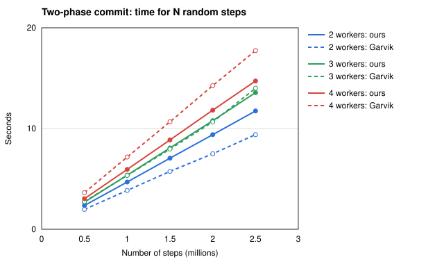
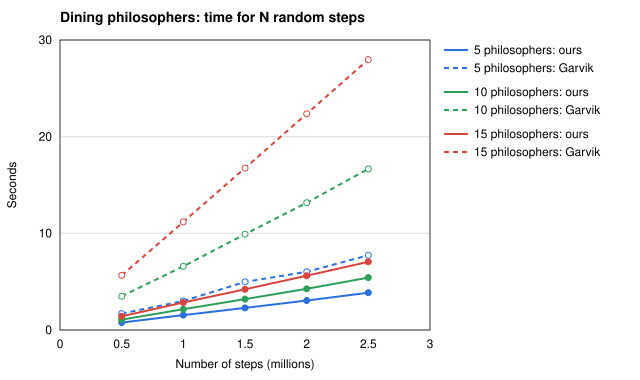

# Performance: Garvik's experiments repeated

Garvik (2022), chapter 6, measures his F# simulator in two ways. This file repeats both, with his
tool and ours **on the same machine**, on the same models.

1. **Simulation speed** (his section 6.3, Figures 6.2 and 6.4): the time to execute 0.5 to 2.5
   million random steps of the two-phase commit protocol with 2, 3 and 4 workers, and of the dining
   philosophers with 5, 10 and 15 philosophers.
2. **State space exploration** (his section 6.2, Table 6.1): nodes, arcs and time for 11 models,
   checked against the CPN Tools reports in his Appendix B.

## Summary

| | Result on the same machine |
|---|---|
| Simulation | **His compiled F# is faster on 4 of 6 models** (1.25–1.9×), equal on one, and ours is faster on the largest two-phase commit (1.2×). Ours slows down less as models grow. |
| State space | **Ours is faster on every model above 13 markings**: 1.5× to over 500×, because his exploration is quadratic in the number of markings. His is faster on the two smallest models (11 and 13 markings), where both take under half a millisecond. |
| Correctness | Both tools give the same node and arc counts as CPN Tools on all models they finish. |
| Features | His tool needs the model rewritten in F# and recompiled for every change of size; ours runs the CPN Tools files as they are ([comparison.md](comparison.md)). |

So the honest claim for the thesis is: **as fast as compiled code within a factor of 2 for
simulation, while interpreting the original CPN ML; much faster for state spaces.** Faster
simulation than his is not reached yet; [what would get there](#what-would-make-simulation-faster)
is at the end.

An earlier version of this file compared our times with the times printed in his thesis, measured
on a slower machine (M1 Max) with .NET 6. That made ours look 1.0–2.2× faster. On the same machine
the picture changes, which is why the comparison below uses only same-machine numbers.

## Setup

| | Garvik's tool | Ours |
|---|---|---|
| Machine | MacBook Air, Apple M3, 8 GB (the same machine) | same |
| Runtime | .NET 8.0.34 (his projects target .NET 6, which is no longer available; run with roll-forward), F# language version 6, Release build | JVM 21 (Temurin) |
| Model | F# code generated by his compiler from his `.cpn` files, with the size constant changed (`let W = 3`) and recompiled for each size | The `.cpn` / `.cpnd` file, size set with `--set W=3` |
| Inscriptions | F#, compiled | CPN ML, interpreted |
| What is timed | His own code: the `jump N` fold of his simulator and his `stateSpaceExplore`, called from a stopwatch harness | `cpn bench` |
| Protocol | 100 000 warm-up steps, then the median of 3 runs (simulation) or 5 runs (state space) | same |
| Choice of the next step | Uniform over all enabled bindings | As CPN Tools: a transition uniformly, then one of its bindings |

To reproduce ours:

```bash
./gradlew :cpn-cli:installJvmDist
python3 scripts/benchmark.py --repeat 3 --out benchmarks/results/NAME.json
python3 scripts/plot-benchmark.py benchmarks/results/NAME.json docs/figures benchmarks/results/GARVIK.json
```

Raw results for both tools are in [benchmarks/results/](../benchmarks/results/). His tool's
repository is private, so the harness around his code is not in this repository; the method is
described in the JSON file.

## Simulation: time for N random steps

Seconds, his vs ours, same machine. In brackets: his time divided by ours (above 1 means ours is
faster).

| Model | Size | 0.5M steps | 1M | 1.5M | 2M | 2.5M |
|---|---|---|---|---|---|---|
| Two-phase commit | 2 workers | 2.0 vs 2.4 (0.83) | 3.9 vs 4.7 (0.82) | 5.8 vs 7.1 (0.81) | 7.5 vs 9.4 (0.80) | 9.4 vs 11.7 (0.80) |
| Two-phase commit | 3 workers | 2.8 vs 2.7 (1.02) | 5.3 vs 5.4 (0.99) | 8.0 vs 8.1 (0.99) | 10.7 vs 10.8 (0.99) | 14.0 vs 13.6 (1.03) |
| Two-phase commit | 4 workers | 3.6 vs 3.0 (1.20) | 7.2 vs 5.9 (1.21) | 10.7 vs 8.9 (1.20) | 14.3 vs 11.8 (1.21) | 17.7 vs 14.7 (1.21) |
| Dining philosophers | 5 | 1.7 vs 3.0 (0.57) | 3.0 vs 5.9 (0.51) | 5.0 vs 8.8 (0.56) | 6.0 vs 11.8 (0.51) | 7.7 vs 14.7 (0.52) |
| Dining philosophers | 10 | 3.5 vs 4.9 (0.71) | 6.6 vs 9.8 (0.67) | 9.9 vs 14.6 (0.68) | 13.2 vs 19.6 (0.67) | 16.7 vs 24.4 (0.68) |
| Dining philosophers | 15 | 5.6 vs 6.9 (0.81) | 11.2 vs 13.7 (0.81) | 16.7 vs 20.6 (0.81) | 22.4 vs 27.6 (0.81) | 28.0 vs 35.2 (0.80) |





Solid lines are ours, dashed lines his tool on the same machine.

- Both tools are linear in the number of steps; neither slows down over long runs.
- His compiled code is faster on small models: 1.9× on 5 philosophers, 1.25× on 2 workers.
- **Ours scales better with the size of the model.** From 2 to 4 workers his time grows by 89 %,
  ours by 25 %; from 5 to 15 philosophers his grows 3.6×, ours 2.4×. The ratio moves in our
  favour with every size step, and on 4 workers ours is 1.2× faster.
- Runs of the same measurement differ by less than 8 % for both tools, except his shortest runs
  (up to 24 % at 0.5M steps).

**Compared with his thesis.** His tool runs about twice as fast here as in his Figures 6.2 and 6.4
(9.4 s instead of 19.5 s for 2.5M steps with 2 workers): the M3 and .NET 8 are both faster than
the M1 Max and .NET 6 he used. Only same-machine numbers are compared above.

## State space exploration

| Model | Size | Nodes | Arcs | Same as CPN Tools | His (ms) | Ours (ms) | His / ours | His thesis (ms) | CPN Tools (s) |
|---|---|---|---|---|---|---|---|---|---|
| Two-phase commit | 2 workers | 43 | 64 | yes | 5.3 | 1.1 | 4.8 | 31 | 0 |
| Two-phase commit | 3 workers | 281 | 512 | yes | 136 | 6.3 | 22 | 38 | 0 |
| Two-phase commit | 4 workers | 2 323 | 4 774 | yes | 14 475 | 39.8 | 364 | 99 | 0 |
| Dining philosophers | 5 | 11 | 30 | yes | 0.18 | 0.4 | 0.45 | 22 | 0 |
| Dining philosophers | 10 | 123 | 680 | yes | 29 | 4.4 | 6.6 | 28 | 0 |
| Dining philosophers | 15 | 1 364 | 11 310 | yes | 5 152 | 49.6 | 104 | 155 | 1 |
| Simple protocol | | 428 | 1 130 | yes | 275 | 11.8 | 23 | 44 | 0 |
| Resource allocation | | 13 | 20 | yes | 0.19 | 0.4 | 0.48 | 26 | 0 |
| Distributed database | 3 | 28 | 42 | yes | 1.2 | 0.8 | 1.5 | 27 | 0 |
| Distributed database | 6 | 1 459 | 4 872 | yes | 8 309 | 38.9 | 214 | 114 | 1 |
| Distributed database | 9 | 59 050 | 314 946 | yes (ours) | not finished in 15 min | 1 759 | > 500 | 12 685 | 1 272 |

"Same as CPN Tools" compares with Garvik's Appendix B. "CPN Tools (s)" is the time in that
appendix, which CPN Tools reports in whole seconds; it was measured on Garvik's machine. Both tools
store every marking and arc; neither time includes a report.

- **His exploration is quadratic.** For each marking it appends to an immutable list
  (`queue @ new`) and computes `Set.difference explored' explored`, both of which take time
  proportional to everything found so far (`examples/StateSpaceExploration.fs`). Measured: 8 times
  more markings (281 → 2 323) take 106 times longer. Ours keeps a hash table from marking to node
  and uses the array of nodes as the queue, so its time grows linearly.
- With 9 databases his exploration had not finished after 15 minutes and was stopped. Going by
  how it grows, it would take hours; his thesis reports 12.7 s and CPN Tools 1 272 s.
- **His published code does not reproduce his Table 6.1 times.** On this machine, which is faster
  than his, it takes 14.5 s for 4 workers, where his table says 99 ms, and 8.3 s for 6 databases
  instead of 114 ms. The node and arc counts do match. Most likely the times in his thesis were
  measured with a different version of the code than the one in the repository; we cannot check
  this.

## What made the difference so far

Before any tuning, 15 dining philosophers took 11.4 s for 0.5M steps. A profile (Java Flight
Recorder) showed 40 % of the time spent looking up names in the interpreter, and half of that in
rebuilding each name's text with `joinToString` on every lookup. Computing the text once brought it
to 6.9 s. Nothing else was tuned.

## What would make simulation faster

Where the time goes now (profile of 15 philosophers): looking up names in hash maps of strings
(about 30 %), building multisets for arc expressions (about 15 %), and evaluating the same arc
expression many times with the same bound values. In order of expected gain:

1. **Resolve names once, before running**: turn each inscription into a closure with variables at
   fixed slots, instead of walking the syntax tree with string lookups. This is what his compiler
   gets for free from F#, and it is the main reason for his lead on small models.
2. **Cache arc expressions on their bound values**, where the expression is pure (no `ran`, `time()`
   or references): `Chopsticks(p)` has only 15 possible results.
3. **Recompute only the transitions next to the one that fired**, as CPN Tools does. No gain on the
   dining philosophers (every transition touches every place), but large gains on models with many
   transitions, such as the pathology lab (F15).

## Threats to validity

- His tool ran on .NET 8 instead of .NET 6 (no longer available), which should favour him.
- The two tools pick the next step differently, so they do not run the same sequence of steps;
  over millions of steps the mix of transitions is similar, but not equal.
- Timing on a laptop: both tools were run one at a time with nothing else heavy running, after a
  warm-up, and the raw time of every run is in the JSON files.
- One machine. Other machines may change the ratios, though not the quadratic growth of his state
  space exploration.
